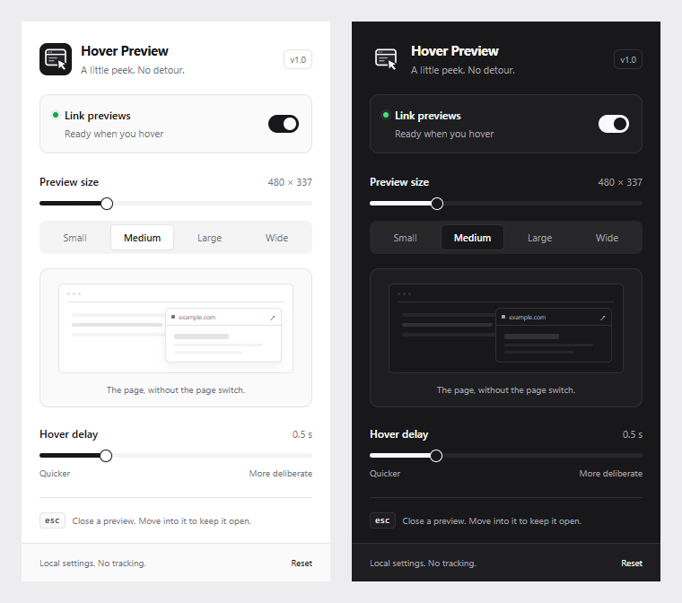

<p align="center">
  
</p>

<h1 align="center">Hover Preview</h1>

<p align="center">
  <strong>A little peek. No detour.</strong><br>
  Preview links without losing your place. A quiet, lightweight extension for a less tab-heavy browser.
</p>

<p align="center">
  <strong>Built with</strong><br>
  
  
  
  
</p>

<p align="center">
  <a href="#install-locally">Install</a> &middot;
  <a href="#what-you-can-do">Features</a> &middot;
  <a href="#privacy-and-permissions">Privacy</a> &middot;
  <a href="https://github.com/SanekxArcs/hover-preview/issues">Report an issue</a>
</p>

<p align="center">
  
</p>

## What is Hover Preview?

Hover Preview opens a small, scaled view of a linked page when you pause over a link. Move your pointer into the card to explore it, open the original in a new tab, or dismiss it and keep reading.

The interface takes its cues from **shadcn/ui**: neutral colors, fine borders, deliberate spacing, compact controls, and clear focus states. It uses native HTML, CSS, and JavaScript, not React or the shadcn component package. No bundler, framework, account, or backend is required.

## What you can do

| Area                    | Highlights                                                                                                              |
| ----------------------- | ----------------------------------------------------------------------------------------------------------------------- |
| **Link previews**       | Hover over an HTTP(S) link to load a sandboxed preview at a 1280 × 800 page viewport.                                   |
| **Your preferred size** | Choose Small, Medium, Large, or Wide, or adjust the width from 320 to 1000 px. The card shrinks to fit smaller windows. |
| **Your preferred pace** | Set the hover delay from 0.2 to 1.5 seconds; the default is 0.5 seconds.                                                |
| **Quick controls**      | Pause previews globally, open the link in a new tab, close the card, or reset preferences.                              |
| **Polished by default** | Automatic system light/dark themes, keyboard-accessible settings, reduced-motion support, and a custom icon.            |
| **Local preferences**   | Settings persist on this device and apply to already-open pages without a refresh.                                      |

## Install locally

This repository is an **unpacked extension**, not a Chrome Web Store listing.

1. Clone or download this repository:

   ```sh
   git clone https://github.com/SanekxArcs/hover-preview.git
   cd hover-preview
   ```

2. Open `chrome://extensions` in Chrome or `edge://extensions` in Edge.
3. Turn on **Developer mode**.
4. Select **Load unpacked** and choose the folder containing `manifest.json`.
5. Pin **Hover Preview** from your browser's Extensions menu.
6. Refresh any website tabs that were open before installation.

No `npm install` or build step is necessary. After changing extension code, click **Reload** on the extension card and refresh the website tab again.

## Using previews

- Hover over a link and wait for your configured delay.
- Move into the preview within 250 ms to keep it open.
- Use **↗** to open the original link in a new tab.
- Press **Esc** while the parent page has focus, click **×**, move away, click outside, or scroll the parent page to dismiss it.
- Open the toolbar popup to change the size, hover delay, or enabled state.

Download links, non-web links such as `mailto:`, credential-bearing URLs, and same-page links are skipped. A link to another origin with the same path is still eligible.

## Compatibility and limitations

- Some websites explicitly disallow embedding with `X-Frame-Options` or CSP. Hover Preview **respects those protections**; it does not strip security headers. Use **Open page** if a preview is blank or blocked.
- A page's own CSP may also block outbound frames. The browser does not reliably reveal whether a cross-origin frame rendered successfully, so the open-page fallback remains available after loading or a six-second timeout.
- The sandbox allows scripts, but not same-origin privileges, forms, popups, downloads, or top-level navigation. Sign-in, cookies/storage-dependent apps, and some JavaScript-heavy sites may not work in previews. Use the full page for those tasks.
- Browser settings pages, the Chrome Web Store, PDF viewers, and other browser-protected pages are not supported. Previews are injected only into top-level HTTP(S) pages, not nested frames or links hidden inside a site's shadow roots.
- Esc is handled by the parent page; if focus is inside a cross-origin preview, use the card's close button instead.

Version 1.0 replaces the old global frame-header bypass with sandboxed previews and an explicit fallback. The old `enabled` and `width` preferences are preserved.

## Privacy and permissions

| Access                  | Why it is needed                                                                                                             |
| ----------------------- | ---------------------------------------------------------------------------------------------------------------------------- |
| `storage`               | Saves enabled state, preview width, and hover delay locally.                                                                 |
| HTTP(S) content scripts | Detects links and displays the preview card on the pages you visit. The browser may describe this as access to website data. |

The extension includes **no analytics, telemetry, remote code, or external font requests**. It does not store your browsing history or link list, and it does not request tab, history, or network-header modification permissions.

Hovering an eligible link **does make a network request to that website**, just like opening a page. The destination and its embedded services may log requests and run their own scripts. This is a live preview, not an anonymous screenshot service. The iframe does not send a referrer, and its contents are unloaded when the card closes.

## Development

Node.js **22 or newer** is needed only for the optional validation and packaging commands. They use Node built-ins and install no packages.

| Command           | What it does                                                                                                               |
| ----------------- | -------------------------------------------------------------------------------------------------------------------------- |
| `npm run check`   | Checks JavaScript syntax, manifest/version consistency, referenced assets, PNG dimensions, and the minimal permission set. |
| `npm run package` | Runs checks and creates `dist/hover-preview-1.0.0.zip` with only the loadable extension files.                             |

### Manual release checklist

1. Load the extension and check the browser's extension error panel.
2. Check light/dark themes, all size presets, sliders, pause/resume, reset, and preference persistence after reopening the popup.
3. Hover an embeddable link, a blocked site, an external same-path link, a nested link label, a download, and a same-page anchor.
4. Check the 250 ms pointer handoff, Esc, close, open-in-new-tab, scrolling, small windows, and timeout fallback.
5. Run `npm run check` and `npm run package` before sharing the ZIP.

Structural checks are not a substitute for testing real website compatibility in your browser.

## Project map

```text
manifest.json       Manifest V3 configuration and minimal permissions
settings.js         Shared defaults, bounds, and preview sizing
popup.html          Toolbar settings interface
popup.css           Shadcn-inspired light/dark styling
popup.js            Preference controls and local storage
content.js          Sandboxed, viewport-aware link preview lifecycle
icons/              SVG source and browser-ready PNG icons
docs/               README preview image
scripts/            Dependency-free validation and ZIP packaging
```

## Contributing

Keep changes focused and preserve the no-build installation path. Validate with `npm run check`, test the unpacked extension, and include screenshots for visual changes. Never add a global security-header bypass or claim that every website supports previews.

<p align="center">
  <sub>Made by <a href="https://github.com/SanekxArcs">SanekxArcs</a> for a calmer browsing workflow.</sub><br>
  <sub>README badges powered by <a href="https://shieldcn.dev">shieldcn.dev</a>.</sub>
</p>
